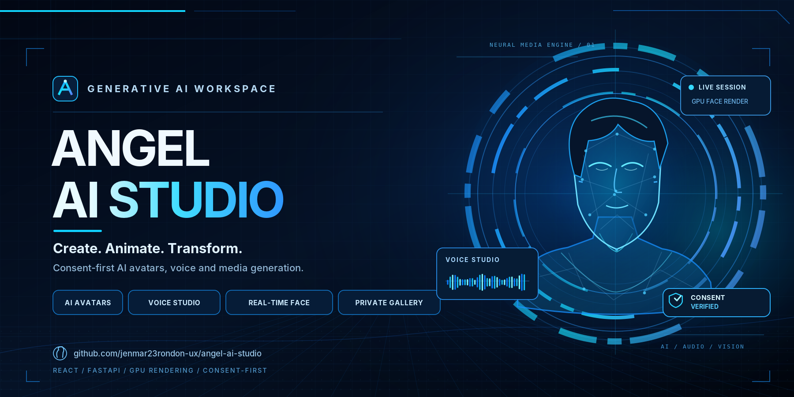

<p align="center">
  
</p>

# angel-ai-studio

Consent-based AI avatar and media generation platform.

This repository is a production-oriented starter for an AI media platform with:

- React, TypeScript and Vite web app
- Node.js, Express and TypeScript API
- PostgreSQL and Prisma data model
- Redis/BullMQ worker pipeline
- FastAPI AI service boundary
- FastAPI audio service boundary for voice conversion, accents and translation
- GPU-backed neural face reenactment mode for camera-driven avatar sessions
- Docker Compose for local infrastructure
- Safety, consent and audit-first architecture

## Local setup

```bash
cp .env.example .env
pnpm install
pnpm prisma:generate
docker compose up postgres redis -d
pnpm dev
```

For API-only local testing without Redis, keep `ENABLE_QUEUE=false`.

Open:

- Web: http://localhost:5173
- API health: http://localhost:4000/health
- AI service, if started separately: http://localhost:8000/health
- Audio service, if started separately: http://localhost:8100/health

## MVP scope

The first version focuses on a complete, consent-based generation loop:

1. User chooses generation type and confirms rights/consent.
2. API validates request and creates a generation job.
3. Worker sends the job to one AI provider adapter.
4. Output is stored and shown in the private gallery.

Provider integrations are intentionally isolated behind adapters so the MVP can start with one provider, such as `fal.ai` or Replicate.

## Voice Studio

The app now includes a `Voice Studio` mode for recorded audio workflows:

- Change voice while keeping the same words.
- Record from the browser microphone and preview the captured audio locally.
- Preserve rhythm and emotion when the provider supports it.
- Apply accent targets such as British, Mexican Spanish or Colombian Spanish.
- Translate between English, Spanish, Portuguese and French.
- Keep consent checks required for cloned or uploaded voices.

## Real-Time Neural Face

The web app includes a `Real-time face` mode backed by FasterLivePortrait on a
persistent NVIDIA GPU. MediaPipe provides browser tracking and metrics, while a
signed WebSocket session streams camera frames directly to the neural renderer.
The former browser photo-warp renderer has been removed.

See `docs/realtime-face.md` and `gpu-service/README.md` for deployment and
configuration.
